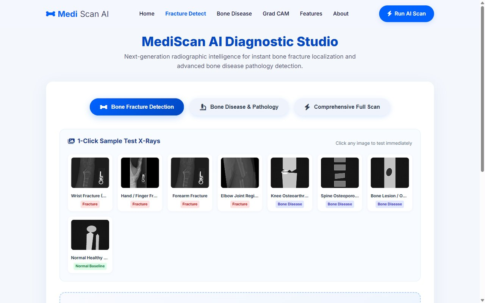
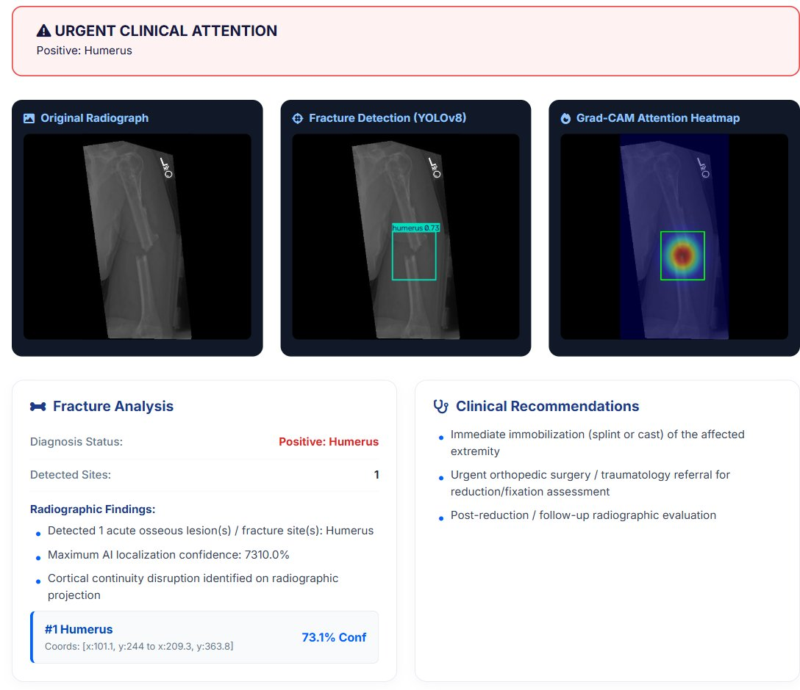
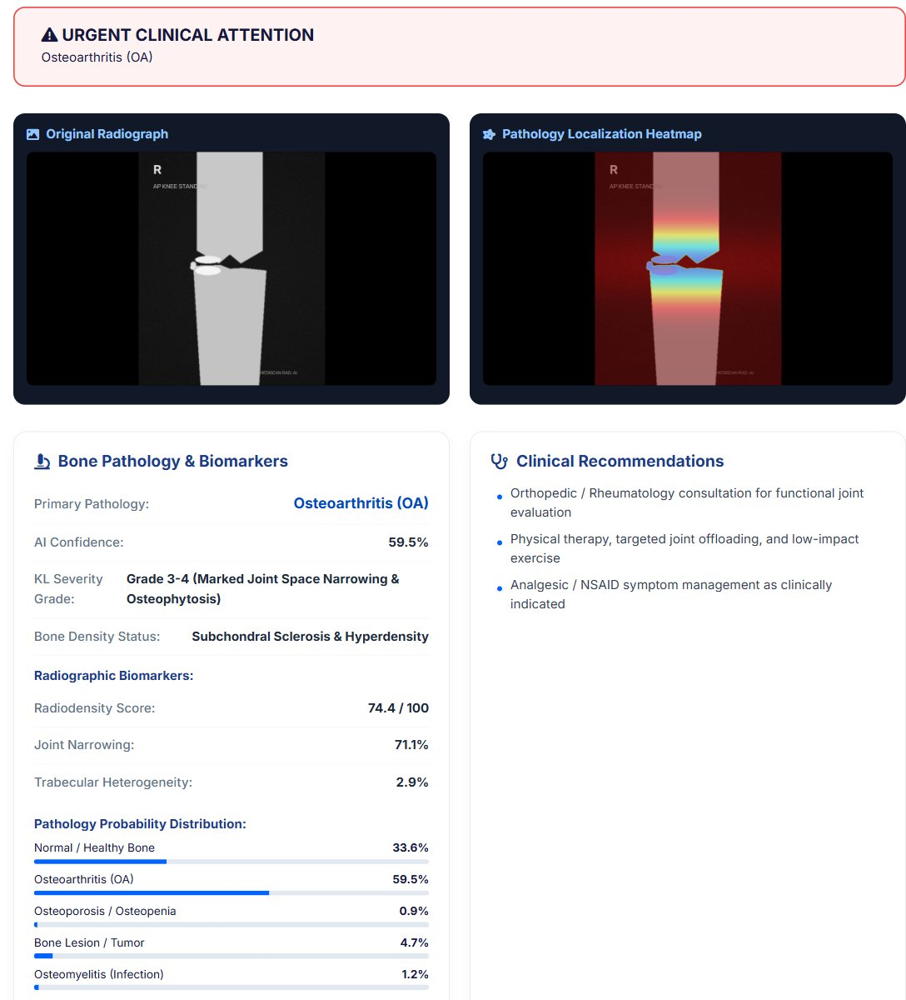
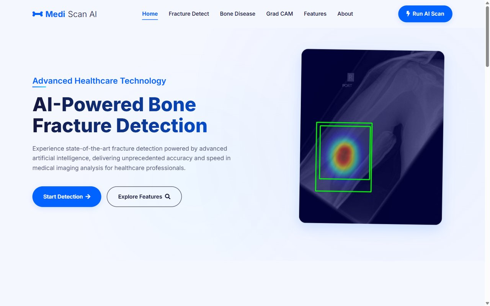
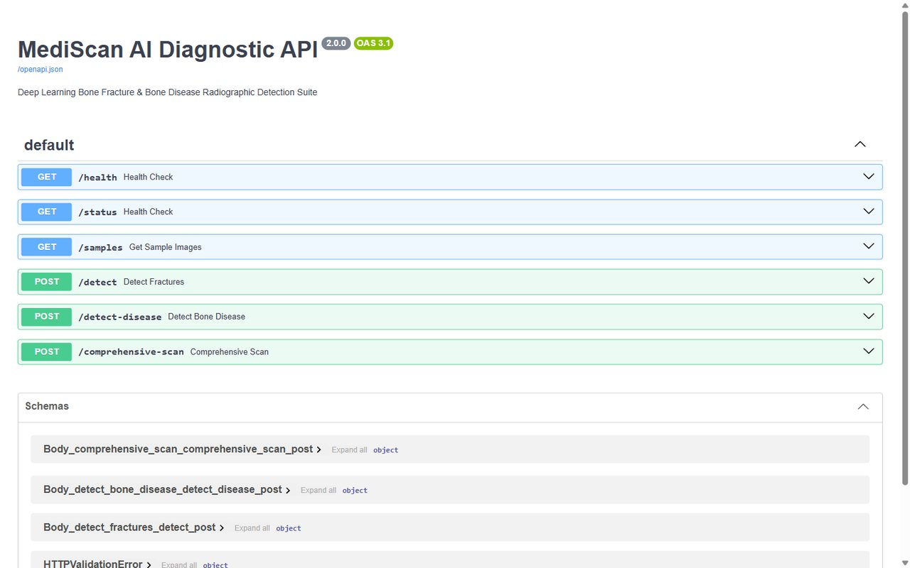
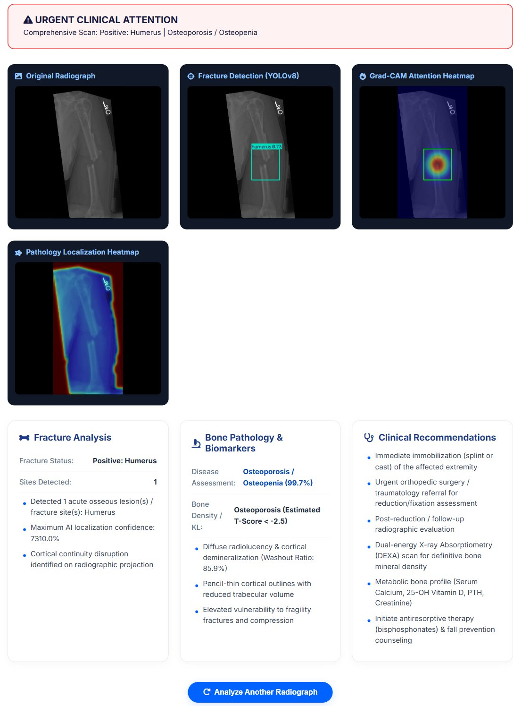

<div align="center">

# 🦴 MediScan AI

### Bone Fracture & Bone Disease Detection from X-Rays — YOLOv8 · FastAPI · Visual Heatmaps


<i>An AI-powered web application that localises bone fractures on X-ray images, shows where the model is looking, and screens for common bone diseases — all from the browser.</i>



</div>

> [!WARNING]
> **Research / educational prototype — not a medical device.** MediScan's outputs (fracture boxes, heatmaps, disease labels, severity and triage) are **not clinically validated** and must not be used for diagnosis or treatment decisions.

---

## 📑 Table of Contents

- [Overview](#-overview)
- [Features](#-features)
- [Screenshots](#-screenshots)
- [Tech Stack](#-tech-stack)
- [Project Structure](#-project-structure)
- [Getting Started](#-getting-started)
- [Usage](#-usage)
- [API Reference](#-api-reference)
- [Running Tests](#-running-tests)
- [Model Training & Performance](#-model-training--performance)
- [Known Limitations](#-known-limitations)
- [Team](#-team)
- [License](#-license)

---

## 📋 Overview

Subtle fractures are among the most frequently missed findings on plain radiographs. MediScan is a decision-support prototype that brings three things together in one easy-to-use web app:

1. **Fracture detection** — a YOLOv8s model fine-tuned on bone radiographs draws bounding boxes around suspected fractures with a confidence score.
2. **Visual interpretability** — a colour-mapped attention overlay highlights each detected region so the result can be checked at a glance.
3. **Bone-disease screening** — a biomarker engine estimates the likelihood of osteoarthritis, osteoporosis, focal lesions and osteomyelitis.

Everything is served by a single **FastAPI** backend with a responsive **HTML/CSS/JavaScript** frontend, and runs on an ordinary laptop **CPU** (median fracture-detection request ≈ **0.18 s**).

---

## ✨ Features

| Mode | What it does |
|---|---|
| 🦴 **Bone Fracture Detection** | YOLOv8s localisation across 7 classes (elbow, fingers, forearm, humerus, humerus fracture, shoulder, wrist), annotated image, attention heatmap and a structured clinical summary with triage |
| 🔬 **Bone Disease & Pathology** | Bone-tissue segmentation and radiographic biomarkers (radiodensity, sclerosis, joint narrowing, cortical gradient, texture) → probabilities for *Normal, Osteoarthritis, Osteoporosis/Osteopenia, Bone Lesion/Tumor, Osteomyelitis*, KL-style grade and a class-specific heatmap |
| ⚡ **Comprehensive Scan** | Runs both engines on one image and returns a combined **master triage** |

Plus:

- 🖼️ **1-click sample gallery** — test the app instantly with built-in X-rays
- 📤 Drag-and-drop upload (JPG / PNG)
- 📖 Interactive API docs (Swagger UI) at `/docs`
- ✅ Automated API test suite

---

## 🖼️ Screenshots

| Fracture detection | Bone disease analysis |
|---|---|
|  |  |

| Landing page | Interactive API docs |
|---|---|
|  |  |

<details>
<summary><b>Comprehensive scan (click to expand)</b></summary>



</details>

---

## 🛠️ Tech Stack

| Layer | Technologies |
|---|---|
| Deep learning | PyTorch, Ultralytics YOLOv8 (YOLOv8s, COCO-pretrained) |
| Image processing | OpenCV, NumPy, Pillow |
| Backend / API | FastAPI, Uvicorn, python-multipart |
| Frontend | HTML5, CSS3, vanilla JavaScript (Fetch API), Font Awesome |
| Training | Jupyter / Google Colab, Matplotlib, Seaborn, scikit-learn |
| Testing | pytest, FastAPI `TestClient` |

---

## 📁 Project Structure

```
MediScan/
├── run.py                    # 1-click launcher (starts server + opens browser)
├── requirements.txt          # Python dependencies
├── backend/
│   ├── app.py                # FastAPI app: routes, YOLOv8 inference, heatmaps, static mounts
│   ├── disease_analyzer.py   # Bone-disease biomarker engine
│   ├── generate_samples.py   # Syncs the sample gallery images
│   ├── test_api.py           # Automated API tests
│   ├── models/model.pt       # Trained YOLOv8s fracture weights (~22 MB)
│   ├── uploads/              # Uploaded images      (created at runtime, git-ignored)
│   └── results/              # Generated outputs    (created at runtime, git-ignored)
├── frontend/                 # Static web UI served at "/"
│   ├── index.html            # Landing page
│   ├── detect.html           # Diagnostic Studio (3 analysis modes)
│   ├── disease.html          # Bone-disease page
│   ├── gradcam.html          # Heatmap explainer page
│   ├── features.html, about.html
│   ├── detect-script.js      # Studio controller (upload, API calls, rendering)
│   ├── nav-*/footer-*        # Shared navigation & footer fragments
│   └── styles.css
├── sample_xrays/             # Built-in sample radiographs
├── models/yolo_model.ipynb   # YOLOv8 training & evaluation notebook
├── graphs/                   # Training / evaluation plots
└── docs/screenshots/         # Images used in this README
```

---

## 🚀 Getting Started

### Prerequisites

- **Python 3.10 – 3.12** (tested with 3.11)
- **pip**
- ~2 GB free disk space for PyTorch
- A GPU is **optional** — everything runs on CPU

### 1. Clone the repository

```bash
git clone https://github.com/jayeshyedge20/mediscan.git
cd mediscan
```

### 2. Create and activate a virtual environment

**Windows (PowerShell)**

```powershell
python -m venv .venv
.venv\Scripts\Activate.ps1
```

**macOS / Linux**

```bash
python3 -m venv .venv
source .venv/bin/activate
```

### 3. Install dependencies

```bash
# (Recommended for CPU-only machines) install the lighter CPU build of PyTorch first
pip install torch torchvision --index-url https://download.pytorch.org/whl/cpu

# Install the remaining requirements
pip install -r requirements.txt
```

> 💡 Have an NVIDIA GPU? Skip the first command and install the matching CUDA build from [pytorch.org](https://pytorch.org/get-started/locally/) instead.

### 4. Run the application

```bash
python run.py
```

This starts the server and opens your browser automatically:

| URL | What you get |
|---|---|
| http://localhost:8000/ | Web application |
| http://localhost:8000/detect.html | Diagnostic Studio |
| http://localhost:8000/docs | Interactive API documentation |

Stop the server with **Ctrl + C**.

<details>
<summary><b>Alternative: run with Uvicorn directly (development / auto-reload)</b></summary>

```bash
cd backend
uvicorn app:app --reload --host 127.0.0.1 --port 8000
```

Then open http://localhost:8000/ manually.

> Note: `run.py` re-syncs the sample gallery images on every launch; running Uvicorn directly skips that step.

</details>

---

## 🧪 Usage

1. Open the **Diagnostic Studio** (`/detect.html`).
2. Choose a mode: **Bone Fracture Detection**, **Bone Disease & Pathology** or **Comprehensive Full Scan**.
3. Either **click a sample X-ray** (analysis starts immediately) or **drag & drop / browse** your own JPG/PNG image and press **Analyze X-Ray**.
4. Review the triage banner, the image panels (original, detection, heatmap) and the clinical cards.

---

## 📡 API Reference

All analysis endpoints accept `multipart/form-data` with a single field named **`file`**.

| Endpoint | Method | Description |
|---|---|---|
| `/detect` | `POST` | Fracture detection — boxes, confidences, annotated image, attention heatmap, clinical summary |
| `/detect-disease` | `POST` | Bone-disease analysis — primary class, probabilities, severity, biomarkers, heatmap |
| `/comprehensive-scan` | `POST` | Both analyses + `master_triage` |
| `/samples` | `GET` | List of built-in sample X-rays |
| `/health` · `/status` | `GET` | Health check |
| `/docs` | `GET` | Swagger UI |

**Example requests**

```bash
# Fracture detection
curl -X POST http://localhost:8000/detect -F "file=@sample_xrays/elbow_fracture.jpg"

# Bone disease analysis
curl -X POST http://localhost:8000/detect-disease -F "file=@sample_xrays/osteoarthritis_knee.jpg"

# Comprehensive scan
curl -X POST http://localhost:8000/comprehensive-scan -F "file=@sample_xrays/elbow_fracture.jpg"
```

<details>
<summary><b>Example <code>/detect</code> response</b></summary>

```json
{
  "detection_id": "3f9c…e21",
  "mode": "fracture",
  "message": "Bone fracture detection completed successfully",
  "result_image": "/results/3f9c…e21_result.jpg",
  "gradcam_image": "/results/gradcam/3f9c…e21_gradcam.jpg",
  "original_image": "/uploads/3f9c…e21.jpg",
  "detections_count": 1,
  "detections": [
    {
      "id": 1,
      "class": "humerus",
      "formatted_class": "Humerus",
      "confidence": 73.1,
      "box": { "x1": 101.1, "y1": 244.0, "x2": 209.3, "y2": 363.8 }
    }
  ],
  "clinical_summary": {
    "status": "Positive: Humerus",
    "severity": "Severe",
    "triage": "Urgent / Orthopedic Consult",
    "findings": ["…"],
    "recommendations": ["…"]
  }
}
```

</details>

---

## ✅ Running Tests

The test suite calls every endpoint through FastAPI's `TestClient` using the real model.

```bash
# FastAPI 0.103's TestClient requires httpx < 0.28
pip install "httpx<0.28"

python -m pytest backend/test_api.py -v
```

Expected result: **5 passed** (`test_health`, `test_samples`, `test_fracture_detect`, `test_disease_detect`, `test_comprehensive_scan`).

---

## 📊 Model Training & Performance

The fracture detector was fine-tuned from COCO-pretrained **YOLOv8s** (see [`models/yolo_model.ipynb`](models/yolo_model.ipynb)):

| Setting | Value |
|---|---|
| Dataset | Roboflow *Bone Fracture Detection* v4 (YOLOv8 export), 7 classes |
| Epochs / batch / image size | 100 / 16 / 416 × 416 |
| Optimizer | AdamW (auto), AMP enabled |
| Parameters | 11.1 M (28.4 GFLOPs) |

**Validation results** (131 images, 157 instances):

| Class | Precision | Recall | mAP@0.5 | mAP@0.5:0.95 |
|---|---|---|---|---|
| **All** | **0.406** | **0.261** | **0.281** | **0.102** |
| forearm fracture | 0.637 | 0.625 | 0.588 | 0.263 |
| humerus | 0.720 | 0.517 | 0.572 | 0.180 |
| shoulder fracture | 0.589 | 0.188 | 0.253 | 0.054 |
| fingers positive | 0.290 | 0.128 | 0.141 | 0.068 |
| elbow positive | 0.198 | 0.105 | 0.110 | 0.040 |
| wrist positive | 0.000 | 0.000 | 0.020 | 0.005 |

**Inference latency** (end-to-end HTTP request, AMD Ryzen 7 laptop, CPU only):

| Endpoint | Median | P95 |
|---|---|---|
| `/detect` | ~178 ms | ~226 ms |
| `/detect-disease` | ~44 ms | ~62 ms |
| `/comprehensive-scan` | ~267 ms | ~310 ms |

The model is strongest on long-bone fractures (forearm, humerus) and weakest on small wrist and finger fractures.

---

## ⚠️ Known Limitations

- **Detection accuracy** is modest (mAP@0.5 = 0.281) — especially for wrist, elbow and finger fractures.
- The **heatmap** is a Grad-CAM-*style* overlay centred on each detected box, not gradient-based Grad-CAM.
- The **bone-disease engine** is rule-based (hand-tuned biomarker weights), not a trained classifier, and it also uses keywords in the uploaded **file name** as a hint — so results for real uploads can depend on how the file is named.
- The disease/normal sample images are **synthetic schematic phantoms** for demonstration.
- In the clinical summary, the "Maximum AI localization confidence" line is shown ×100 (e.g. `7310.0%` for 73.1%), and every positive detection is labelled *Severe*.
- Built for **local use**: CORS allows all origins, there is no authentication or upload-size limit, and uploads are kept on disk indefinitely.

---

## 👥 Team

| Member | Role |
|---|---|
| **Jayesh Yedge** | Dataset curation, preprocessing, YOLOv8 model design, training & tuning |
| **Sarang Beldar** | Visual interpretability pipeline & heatmap generation |
| **Amaan Khan** | FastAPI backend, REST API, inference pipeline & integration |
| **Omkar Kasturi** | Frontend UI/UX, image upload interface & report viewer |

B.E. Project, Computer Science and Engineering (IOTCSBCT) — M. H. Saboo Siddik College of Engineering, Mumbai (University of Mumbai), 2025–2026.

---

## 📄 License

This project is licensed under the **MIT License** — see the [LICENSE](LICENSE) file for details.

<div align="center">
  <sub>© 2026 MediScan AI Team</sub>
</div>
